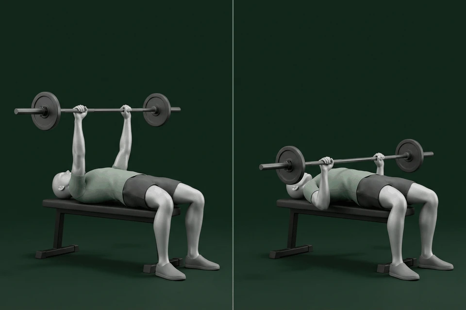
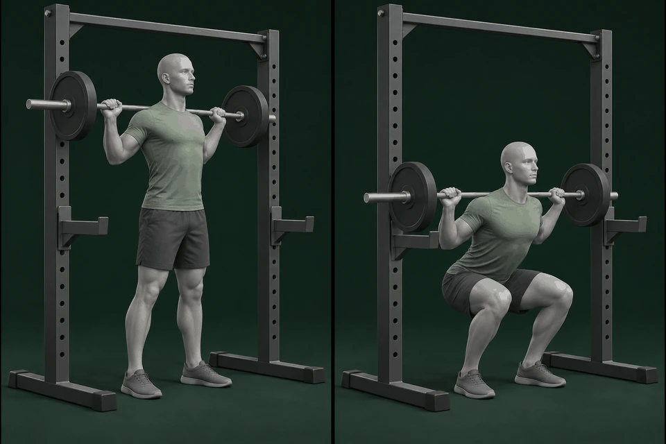
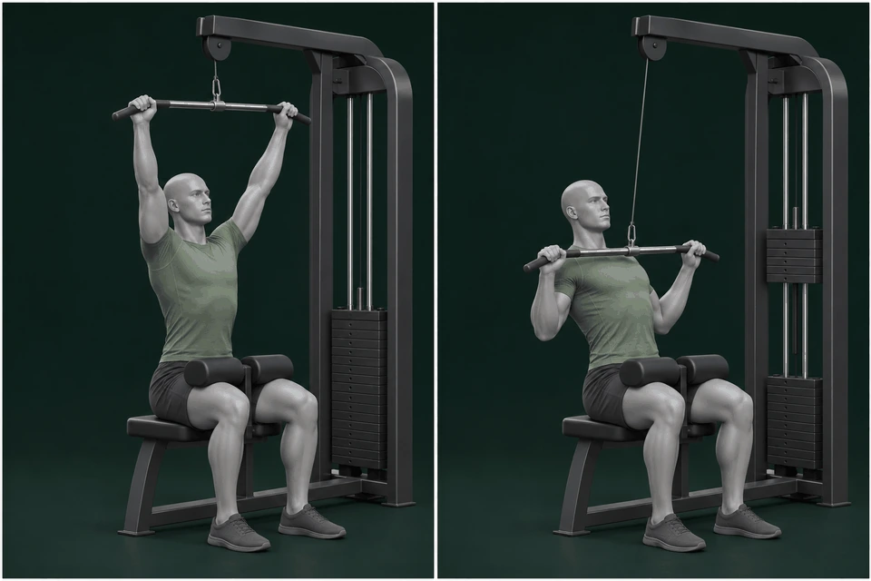

# Forma / فورمة

**Offline-first, privacy-respecting, bilingual (English & Arabic RTL) fitness and nutrition tracker for Android, iPhone, and Apple Watch.**

[](https://github.com/7atem/Forma/actions/workflows/android.yml)
[](https://github.com/7atem/Forma/actions/workflows/apple.yml)
[](LICENSE)


-success)

> **Status: Development Alpha (`0.7.0-alpha07`).**
> *Forma / فورمة* is a working name; no public brand or store listing has been selected. Core logging, encrypted storage, backups, and deterministic summaries work offline without accounts, cloud servers, or telemetry. Public release still requires qualified exercise/media review, physical device testing (paired iPhone + Apple Watch and Gemini Nano hardware), and the usability study in [docs/ROADMAP.md](docs/ROADMAP.md).

---

## Visual Preview — Original Exercise Library

Forma ships **74** original two-phase studio illustrations (`960×640` WebP), **21** detailed muscle regions, and **37** optional bundled AI demonstration videos (review pending; release-blocked until qualified technique review).

| Barbell Bench Press | Barbell Back Squat | Lat Pulldown |
| :---: | :---: | :---: |
|  |  |  |

*Illustrations and optional videos are AI-generated examples, not validated personal coaching. Muscle highlight colors represent catalogued primary/supporting associations, not measured activation or recovery. The experimental procedural 3D motion library (12 clips; [docs/EXERCISE_MOTION.md](docs/EXERCISE_MOTION.md)) is currently hidden behind feature flags (`ENABLE_PROCEDURAL_3D_MOTION = false` / `ExerciseGuideFlags.enableProcedural3DMotion = false`) so both apps focus on Videos, Photos, and 2D muscle highlights.*

---

## Key Features

### Training & Exercise Library
- **74 bilingual exercises** with two-phase `960×640` WebP illustrations, named variation guides, movement cues, enlarged phase viewer, and **37** optional looping demonstration videos (tap-to-pause, progress scrubber, slow-motion toggle).
- **21 detailed muscle regions** (including forearms & grip) with front/back 2D highlights and a **7-day working-set muscle heat map** (warm-ups excluded from working-load charts, records, and weekly muscle counts).
- **Custom Exercises** with user-chosen primary muscle, equipment, set logging, and personal bests.
- **Discomfort & Focus** preferences: separate user choices for discomfort areas (neck, upper back, shoulders, lower back — marked rather than hidden by default) and muscles you want to train more. Never labels exercises as safe, unsafe, or therapeutic ([docs/EXERCISE_DISCOMFORT_FILTERS.md](docs/EXERCISE_DISCOMFORT_FILTERS.md)).
- **Guided Programs & Freestyle Sessions**: user-entered target sets, rep ranges, per-exercise rest timers, linked supersets/circuits, program notes, duplication, repeat-as-new workouts, one-handed set nudges, dumbbell per-hand clarity, warm-up/RPE/RIR tagging, live elapsed workout clock, sticky lock-screen rest chronometer, Olympic barbell plate visualizer + warm-up ramp, live PR & estimated 1RM analytics, and workout recap copy/share.
- **Cardio & Timed Activities**: log activity type, duration, optional distance, and computed pace for walks/runs — no guessed calorie burn, heart rate, or intensity.

### Nutrition, Hydration & Body Tracking
- **42 curated offline starter whole foods & Arabic/Middle Eastern staples** (public-domain USDA FoodData Central CC0 & FAO Near East references; opt-in import into your editable local library).
- **Optional keyless Open Food Facts (ODbL) lookup** by name or native camera barcode scanner (Android & iOS).
- **Immutable history**: logged food and recipe portions keep source snapshots so later edits never rewrite past days.
- **Daily nutrition workflow**: grouped meal diary (including Ramadan Suhoor/Iftar slots), 1-tap frequent meals, saved meal combos, confirmed meal-day copy, offline Food-Swap calculator, macro donut split, daily hydration tracker, and personal supplements/vitamins checklist.
- **Body measurements & sleep**: weight, expanded tape measurements (waist, neck, chest, arms, hips, thighs), **BMI** (number only, from your height and latest logged weight — no category labels or advice), 7-day rolling trends, and read-only sleep duration/stages imported from Health Connect or Apple Health.

### Privacy, Portability & Apple Companion
- **Encrypted local storage**: Android uses **Room v10 + SQLCipher** with Android Keystore key wrapping (explicit `1→2→3→4→5→6→7→8→9→10` migrations, zero destructive fallbacks). Apple stores local state in OS-protected `forma.json`.
- **Portable encrypted backups (`FORMABK1`)**: password-encrypted, authenticated, bounded typed-record archive with preview before transactional replace (keys are never exported; no plaintext staging files).
- **Full CSV export**: Training, Nutrition, and Measurements/Hydration.
- **Read-only health integrations**: optional Android **Health Connect** (weight, exercise sessions, sleep) and iOS **Apple Health** (workouts, body mass, sleep). Imported copies stay labelled, separate from Forma logs/stats/backups, and removable in one step. Forma never requests write permissions.
- **Opt-in local reminders**: off by default; per-kind schedules (meals, water, workout, weekly look-back), rotating non-guilt messages with zero logged data in notifications, skip-if-logged option, +250 ml water action, and 1-hour snooze.
- **Native iPhone & Apple Watch source (`apple/`)**: standalone 4-tab iPhone app + offline Apple Watch logger with durable phone ACK and manual v2 JSON file bridge (`*.formaworkouts`) for Android↔iPhone transfer (v1 reader compatibility retained).

---

## Privacy, AI & Safety Boundaries

| Principle | How Forma Enforces It |
| :--- | :--- |
| **Offline-first** | Core logging, calculations, charts, backups, and weekly reviews work with zero network access. |
| **Zero accounts or telemetry** | No user accounts, analytics SDKs, ad networks, or paid cloud APIs. |
| **Minimal network scope** | Android `INTERNET` permission is used strictly for optional free, public, keyless Open Food Facts lookups. |
| **Constrained on-device AI** | Optional foreground-only **Gemini Nano** (AICore) may only select known computed fact IDs (capped at 64 tokens / 15 s). Raw model prose is never rendered. |
| **No automated prescriptions** | No medical diagnosis, injury treatment, automatic calorie/macro changes, or silent plan writes. Missing logs are treated as *unknown*, never nonadherence. |
| **Independent codebase** | Separate application ID (`com.formacoach.app`), database (`forma.db`), and Keystore alias. Nemory remains untouched at `D:\Vault Brain` ([preservation record](docs/NEMORY_PRESERVATION.md)). |

---

## Architecture & Repository Layout

```text
Forma/
├── app/                # Android Jetpack Compose UI, Hilt DI, WorkManager reminders, Health Connect, widget
├── core/
│   ├── model/          # Shared typed domain models, generated exercise/muscle catalog, discomfort rules
│   ├── coach/          # Deterministic workout insights, weekly reviews, trends, nutrition & plate calculators
│   ├── data/           # Encrypted Room v10 database (SQLCipher), explicit migrations, KeystoreManager
│   ├── backup/         # FORMABK1 authenticated password-encrypted backup/restore
│   └── wearables/      # v1/v2 workout transfer contract & transactional merge
├── apple/              # Native SwiftUI iPhone & watchOS apps + FormaCore Swift package (XcodeGen)
├── catalog/            # Single source of truth JSONs (muscles, guides, art, videos, motion, section info)
├── assets/exercises/   # Canonical 960×640 WebP stills (drawable-nodpi) & optional MP4 videos (raw)
├── scripts/            # Python code generators and strict consistency/art/video/localization validators
└── docs/               # Architecture, validation logs, release checklist, roadmap, reuse audit
```

---

## Building & Verification

### Android (Windows / Linux / macOS)
Requires **JDK 21** and **Android SDK Platform 36** (`build-tools;36.0.0`). Configure ignored `local.properties` or `ANDROID_HOME`.

```powershell
# Run catalog, art, video, localization, and Apple static consistency checks
python scripts/check_localization.py
python scripts/generate_exercise_catalog.py --check
python scripts/generate_exercise_guides.py --check
python scripts/generate_section_info.py --check
python scripts/check_exercise_art.py
python scripts/generate_exercise_motion.py --check
python scripts/check_exercise_video.py
python scripts/check_apple_sources.py

# Run JVM tests, debug/release builds, and Android lint (sequentially on Windows)
.\gradlew.bat :core:coach:test :core:wearables:test :core:backup:test :app:assembleDebug :app:lintDebug :app:assembleRelease --max-workers=1
```

For instrumentation tests on a disposable emulator:
```powershell
.\gradlew.bat :app:connectedDebugAndroidTest --max-workers=1
```

*Release APKs are unsigned; no external signing keys are stored in this repository.*

### Apple (iOS & watchOS)
Native Swift/Xcode builds require macOS (`Xcode` + `xcodegen`). **GitHub Actions `macos-15` CI** verifies `swift test`, `xcodegen generate`, iOS/watchOS Simulator builds, and an unsigned ARM64 iOS IPA artifact. Physical paired iPhone + Apple Watch device tests remain required before distribution ([docs/APPLE_WATCH.md](docs/APPLE_WATCH.md)).

```bash
swift test --package-path apple
cd apple && xcodegen generate
xcodebuild -project FormaApple.xcodeproj -scheme FormaPhone -destination 'generic/platform=iOS Simulator' CODE_SIGNING_ALLOWED=NO build
```

---

## Documentation

| Document | Description |
| :--- | :--- |
| [docs/ARCHITECTURE.md](docs/ARCHITECTURE.md) | System architecture, module boundaries, and storage design |
| [docs/DAILY_WORKFLOW_IMPLEMENTATION.md](docs/DAILY_WORKFLOW_IMPLEMENTATION.md) | Daily logging workflows and `FORMABK1` backup format |
| [docs/APPLE_WATCH.md](docs/APPLE_WATCH.md) | iPhone/watchOS architecture, file bridge, and physical test gates |
| [docs/EXERCISE_MUSCLES.md](docs/EXERCISE_MUSCLES.md) | Muscle taxonomy, 2D region geometry, and catalog generation |
| [docs/EXERCISE_DEMOS_AND_UX.md](docs/EXERCISE_DEMOS_AND_UX.md) | Two-phase WebP illustrations, prompt provenance, and UX |
| [docs/EXERCISE_VIDEO.md](docs/EXERCISE_VIDEO.md) | Optional AI video pipeline, manifest, and review release gate |
| [docs/EXERCISE_DISCOMFORT_FILTERS.md](docs/EXERCISE_DISCOMFORT_FILTERS.md) | Discomfort & focus filter rules and non-clinical boundaries |
| [docs/VALIDATION.md](docs/VALIDATION.md) | Executed test suites, lint runs, and verification evidence |
| [docs/RELEASE_CHECKLIST.md](docs/RELEASE_CHECKLIST.md) | Remaining gates before any public release |
| [docs/ROADMAP.md](docs/ROADMAP.md) | Planned milestones and open studies |
| [docs/CHANGELOG.md](docs/CHANGELOG.md) | Version-by-version release history |
| [docs/NEMORY_PRESERVATION.md](docs/NEMORY_PRESERVATION.md) | Nemory product separation and preservation guarantees |
| [docs/NEMORY_REUSE_AUDIT.md](docs/NEMORY_REUSE_AUDIT.md) | Commit-level provenance and hashes for adapted Apache-2.0 files |

---

## License & Attribution

- **Code License:** [Apache License, Version 2.0](LICENSE) — see [NOTICE](NOTICE) for required attribution notices (including code adapted from the Apache-2.0-licensed Nemory project).
- **Third-Party Licenses & Data Sources:** [THIRD_PARTY_LICENSES.md](THIRD_PARTY_LICENSES.md) (libraries, USDA FDC CC0, FAO Near East references, Open Food Facts ODbL, and media provenance).
- **Security Policy:** [SECURITY.md](SECURITY.md)
- **Contributing:** [CONTRIBUTING.md](CONTRIBUTING.md)
- **Code of Conduct:** [CODE_OF_CONDUCT.md](CODE_OF_CONDUCT.md)
